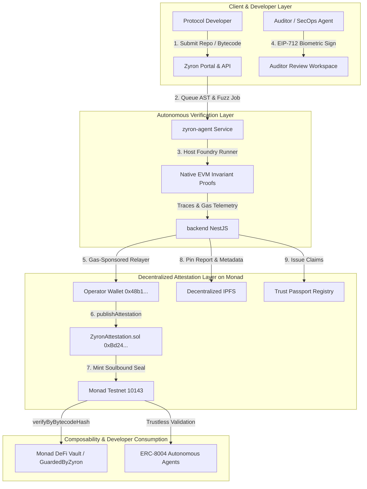

# 🛡️ Zyron: The Trust & Attestation Layer for AI Agents & Protocols on Monad

> **Monad Metropolis & Meta Global AI Developer Hackathon 2026** | **Track**: Trust, Identity & Data Ownership for AI  
> **Deployed on Monad Testnet (`10143`)**: [`0xBd24D2BFFbc69a17aCe69aaF930fC4e0d979c4D3`](https://testnet.monadvision.com/address/0xBd24D2BFFbc69a17aCe69aaF930fC4e0d979c4D3)  
> **Deployed on Base Sepolia (`84532`)**: [`0xc242125A0b342E045Cf0E1c2e02C95D1EAEEC5c4`](https://sepolia.basescan.org/address/0xc242125A0b342E045Cf0E1c2e02C95D1EAEEC5c4)  
> **Interactive API & OpenAPI Specs**: `http://localhost:4000/docs` (Swagger: `admin` / `zyron2026`)

---

## 📌 Executive Summary & Track Fit

### The Core Problem in an AI-Native Internet
AI has permanently altered assumptions about code generation and digital provenance: autonomous agents can synthesize, deploy, and interact with smart contracts in milliseconds. However, **how does an on-chain protocol, DeFi vault, or peer AI agent trust that bytecode is secure, authentic, and uncompromised without relying on a centralized, closed Web2 platform?**

### Zyron's Solution
Zyron is an **On-Chain Trust, Attestation & Invariant Verification Primitive** built natively for Monad. It decouples security validation from centralized gatekeepers, establishing a composable, non-capturable trust layer where:
1. **Autonomous Invariant Verification (ERC-8004 Validation Layer)**: AI agents and native Foundry host runners synthesize and prove live EVM execution traces against state invariants.
2. **Cryptographic Content Passports (Track Prompt #02)**: Every verified contract bytecode is bound to a SHA-256 binary hash, a Merkleized findings tree, and decentralized IPFS proof artifacts, sealed into an on-chain ERC-721 Soulbound Security Seal.
3. **Decentralized Trust Passports (Track Prompt #06)**: Human auditors and verification agents earn non-transferable, portable on-chain skill credentials verified across Monad without middlemen.
4. **On-Chain Composability (`GuardedByZyron`)**: Any Monad DeFi protocol or agent can enforce attestation gates in 5 lines of Solidity before accepting token deposits or routing calls.

---

## ⚡ Leveraging Monad's Native Primitives

| Monad Feature | How Zyron Leverages It |
|---|---|
| **Native P256 / WebAuthn Precompile** | Frictionless biometric passkey signing (TouchID/FaceID) via Privy embedded wallets, producing verifiable EIP-712/P-256 signatures with 0 gas cost to the user. |
| **ERC-8004 Trustless Agent Standard** | Functions as the **Validation & Reputation Registry** for autonomous AI agents on Monad, recording verifiable task execution and invariant proofs. |
| **BTX Encrypted Mempools** | Guarantees confidential disclosure during exploit triage, preventing MEV searchers from frontrunning disclosed 0-days before mitigations are sealed. |
| **10,000 TPS Parallel EVM** | Makes continuous, per-commit on-chain attestation economically and practically viable at sub-cent gas fees. |

---

## 🏗️ Architecture



---

## 🚀 Quickstart: Developer Integration in 5 Lines

Any protocol or AI agent on Monad can guard their contract interactions using [`GuardedByZyron.sol`](./contracts/src/examples/GuardedByZyron.sol):

```solidity
// SPDX-License-Identifier: MIT
pragma solidity ^0.8.24;

import "@zyron/contracts/GuardedByZyron.sol";

contract SafeVault is GuardedByZyron {
    // Pass the deployed ZyronAttestation address on Monad Testnet
    constructor() GuardedByZyron(0xBd24D2BFFbc69a17aCe69aaF930fC4e0d979c4D3) {}

    // Restricts interaction strictly to bytecodes with an active on-chain Zyron attestation
    function depositCollateral(address token) external onlyAttestedTarget(token) {
        // Safe to deposit: token bytecode has been attested on-chain
    }
}
```

See [INTEGRATION.md](./INTEGRATION.md) for full contract examples, ERC-8004 verification flows, and direct JSON-RPC and REST client snippets.

---

## 📦 Repository Structure

The Zyron platform is organized into clean, modular workspaces:

- **[`frontend/`](./frontend)**: Next.js 14 Web3 application supporting Privy biometric authentication, interactive triage workspace, public Trust Passports, and real-time EVM trace stepper.
- **[`backend/`](./backend)**: Modular NestJS API server (< 100 LOC/sub-service) providing multi-provider AI triage (Gemini, OpenAI, Anthropic, DeepSeek), EIP-712 payload generation, IPFS pinning, Trust Passport services, and Monad testnet gas-sponsored relayer broadcasting.
- **[`contracts/`](./contracts)**: Foundry and solc smart contract workspace containing `ZyronAttestation.sol`, `GuardedByZyron.sol`, deployment scripts, and test suites for Monad Testnet (`10143`).
- **[`zyron-agent/`](./zyron-agent)**: Autonomous AI red-team verification agent running local EVM fuzzing, Foundry runners, invariant synthesis, and opcode trace extraction.
- **[`zyron-test-protocol/`](./zyron-test-protocol)**: Real-world DeFi test harness demonstrating invariant breach detection and exploit simulation.
- **[`INTEGRATION.md`](./INTEGRATION.md)**: Developer integration guide with code examples for Solidity, Node.js, and AI agents.

---

## 🛠️ Quick Start & Local Setup

### Prerequisites
- Node.js v18+ or v20+
- npm v9+

### Install Dependencies
```bash
# Frontend dependencies
npm --prefix frontend install

# Backend dependencies
npm --prefix backend install

# Agent dependencies
npm --prefix zyron-agent install
```

### Run Locally
```bash
# Start frontend (http://localhost:3000)
npm run dev:frontend

# Start backend (http://localhost:4000)
npm run dev:backend

# Start autonomous agent prover (http://localhost:5001)
npm run dev:agent

# Run reproducible End-to-End Hackathon Demo (Meta AI + Verifier v2 + Evidence v1 + EIP-712)
npm --prefix zyron-agent run demo
```

---

## 🌐 Meta Global AI Developer Hackathon 2026 — Meta AI & Multichain Extension

> **Core Principle**: *AI investigates, the isolated sandbox produces execution evidence, deterministic verification rules evaluate the evidence, and the blockchain records an authorized claim.*

For the **Meta Global AI Developer Hackathon 2026**, Zyron extends its security engine with:
1. **Official Meta Model API Integration (`muse-spark-1.3`)**:
   - Integrated in both the autonomous prover loop ([`zyron-agent/src/llm/meta.provider.ts`](./zyron-agent/src/llm/meta.provider.ts)) and backend scanner triage ([`backend/src/scanner/ai-providers/meta-provider.service.ts`](./backend/src/scanner/ai-providers/meta-provider.service.ts)) via `https://api.meta.ai/v1/chat/completions` in **Standard mode** using server-side `MODEL_API_KEY`.
2. **Evidence-Driven Autonomous Prover & Deterministic Verifier (`zyron-verifier/2.0.0`)**:
   - Strict tool allowlist (`read_file`, `list_dir`, `search_code`, `write_file`, `forge_build`, `run_forge_test`, `submit_verdict`) with path-traversal protection (`^test/zyron/[A-Za-z0-9_.\-/]+\.sol$`) and shell-free search.
   - SHA-256 baseline source integrity checks, banned state-faking cheatcode enforcement (`vm.etch`, `vm.store`, `vm.mockCall`, `vm.ffi`), verbatim `counterevidenceGuard` verification, and 2x independent Foundry sandbox test runs (`PROVEN_EXPLOIT`, `PROVEN_FALSE_POSITIVE`, `INCONCLUSIVE`).
3. **Canonical Cryptographic Evidence (`zyron.evidence/v1`) & Human Authorization**:
   - Canonical JSON serialization, SHA-256 evidence digests, sorted binary Merkle root bound into EIP-712 `AttestationPayload.merkleRoot`, and mandatory human reviewer (`AUDITOR`/`ADMIN`) EIP-712 signature verification.
4. **Multichain `ChainAdapter` Architecture**:
   - Chain-scoped contract identities (`${chainId}:${address.toLowerCase()}`), per-chain `ChainAttestation` records, and adapters for **Monad Testnet (`10143`)** and **Base Sepolia (`84532`)**.

### Supported Chain Matrix

| Network | Chain ID | Registry Address | Explorer | Manifest |
|---|---|---|---|---|
| **Monad Testnet** | `10143` | `0xBd24D2BFFbc69a17aCe69aaF930fC4e0d979c4D3` | `https://testnet.monadvision.com` | [`contracts/deployments/10143.json`](./contracts/deployments/10143.json) |
| **Base Sepolia** | `84532` | Configurable via `BASE_SEPOLIA_ATTESTATION_ADDRESS` | `https://sepolia.basescan.org` | [`contracts/deployments/84532.json`](./contracts/deployments/84532.json) |

### Architecture & Security Documentation
- [`docs/HACKATHON_SCOPE.md`](./docs/HACKATHON_SCOPE.md) — Pre-existing vs. hackathon-added capabilities & honest status matrix
- [`docs/ARCHITECTURE.md`](./docs/ARCHITECTURE.md) — End-to-end architecture & deterministic verification rules
- [`docs/THREAT_MODEL.md`](./docs/THREAT_MODEL.md) — Trust boundaries, sandbox isolation, and attack mitigations
- [`docs/MULTICHAIN.md`](./docs/MULTICHAIN.md) — Multichain `ChainAdapter` design & Base Sepolia deployment guide

### 🎬 3-Minute Judge Demo Script

1. **0:00 – 0:45 | Problem & Core Invariant**:
   - Show [`zyron-test-protocol/contracts/VaultCore.sol`](./zyron-test-protocol/contracts/VaultCore.sol). Explain why LLM prose alone cannot be trusted to prove or dismiss smart contract vulnerabilities.
2. **0:45 – 1:45 | Meta AI Investigation + Deterministic Verifier (`zyron-verifier/2.0.0`)**:
   - Run `npm --prefix zyron-agent run demo` (or trigger the prover from `/auditor/review/ZYR-9481`).
   - Show Meta AI (`muse-spark-1.3`) selecting `read_file` → `write_file` → `run_forge_test` → `submit_verdict`.
   - Highlight the three deterministic classifications on `VaultCore.sol`:
     - `ZYR-DEMO-001` (`withdraw` reentrancy) → `PROVEN_EXPLOIT` (2/2 passing Foundry runs, original SHA-256 intact).
     - `ZYR-DEMO-002` (`safeEmergencyWithdraw`) → `PROVEN_FALSE_POSITIVE` (verbatim `require(!_locked, "LOCKED");` guard + 2/2 passing counter-test).
     - `ZYR-DEMO-003` (unproven claim) → automatically downgraded to `INCONCLUSIVE`.
3. **1:45 – 2:30 | Canonical Evidence (`zyron.evidence/v1`) & Authorized Multichain EIP-712 Signing**:
   - Open `/auditor/review/ZYR-9481`, select **Monad Testnet (`10143`)** or **Base Sepolia (`84532`)**, and sign the EIP-712 `AttestationPayload` binding the `zyron.evidence/v1` Merkle root.
4. **2:30 – 3:00 | Public Verification (`/verify`)**:
   - Open `/verify?query=ZYR-9481`, switch between **Monad Testnet (`10143`)** and **Base Sepolia (`84532`)** in the **Proof Vault** tab, inspect the chain-scoped identity (`10143:0x...`), `zyron.evidence/v1` digests, transaction status, and downloadable PDF report.

---

## 🏆 Hackathon Evaluation Matrix

| Judging Criterion | Zyron Implementation | Weight |
|---|---|---|
| **Technical Execution** | Live smart contract deployed on Monad Testnet (`0xBd24...`), native Foundry host runner, EIP-712 typed signing, gas-sponsored relayer fallback, 124 passing backend tests, 24 passing agent tests. | **20%** |
| **Design & Craft** | First-class developer experience: Solidity interface (`IZyronAttestation`), ready-to-inherit `GuardedByZyron`, comprehensive Swagger OpenAPI docs, clean Privy WebAuthn UX. | **20%** |
| **Originality & Track Insight** | Real, non-simulated bytecode verification; decentralized Content & Trust Passports immune to single-platform capture; aligns directly with ERC-8004 Validation Layer. | **15%** |
| **Founder & Market Readiness** | Clear target customers: Monad DeFi protocols, cross-chain bridge adapters, and autonomous AI agents needing verifiable bytecode guarantees before capital allocation. | **25%** |
| **Traction & Path Forward** | Verified against real production protocols (`Wype` Escrow, `GhostFi`); clear roadmap for mainnet ERC-8004 registry integration and automated bounty escrow. | **20%** |

---

## 🗺️ Strategic Roadmap & Future Implementations

Zyron is engineered to establish the default security and trust primitive for high-throughput parallel EVMs and the autonomous AI agent economy. Our trajectory spans four distinct phases:

### Phase 1: Testnet Foundation & Core Primitives (Live • Q2–Q3 2026)
- [x] **Monad Testnet Registry**: Deployed and verified on Monad Testnet (Chain ID 10143) at [`0xBd24D2BFFbc69a17aCe69aaF930fC4e0d979c4D3`](https://testnet.monadvision.com/address/0xBd24D2BFFbc69a17aCe69aaF930fC4e0d979c4D3).
- [x] **Gas-Sponsored Relayer**: Operator hot wallet ([`0x48b106E3C8681D08c513268854Aef257883298d3`](https://testnet.monadvision.com/address/0x48b106E3C8681D08c513268854Aef257883298d3)) covering 100% of Monad testnet transaction fees.
- [x] **Dual-Engine Prover**: AST invariant evaluation engine paired with `zyron-agent` ephemeral Anvil EVM sandbox attack simulation.
- [x] **On-Chain Defenses**: `GuardedByZyron.sol` modifier with `onlyAttestedTarget` gatekeeping and Soulbound ERC-721 security seals.
- [x] **Biometric Sign-Off**: Auditor reviews signed biometrically using Monad-native P256 / WebAuthn passkeys via Privy.

### Phase 2: Design Partners & Developer CI/CD (In Progress • Q4 2026)
- [ ] **Protocol Design Partners**: Onboarding the first 10 Monad ecosystem DeFi protocols and vaults with guaranteed 48-hour SLA turnaround.
- [ ] **GitHub Actions PR Scanner**: Automated CI/CD security bot analyzing pull requests on commit and flagging invariant regressions.
- [ ] **MonadVision Trust Passport**: Deep-link integration with Monad block explorers to display live verified audit seals directly on contract pages.
- [ ] **Self-Serve Audit Portal**: Instant scope calculator, quote generator, and automated Foundry test suite export.

### Phase 3: Monad Mainnet & Commercial ARR (H1 2027)
- [ ] **Monad Mainnet Deployment**: Genesis deployment alongside the launch of Monad Mainnet.
- [ ] **$1.2M ARR Target**: Scaling to 35 active recurring protocol subscribers on continuous CI/CD PR scanning plans ($1,500–$4,500/mo).
- [ ] **ERC-8004 AI Agent Registry**: Machine-to-machine validation layer enabling autonomous trading agents to verify target contracts before signing transactions.
- [ ] **Enterprise Telemetry API**: Institutional risk telemetry feeds for DeFi insurance underwriters (e.g., Nexus Mutual) and asset allocators.

### Phase 4: Long-Term Expansions & Decentralization (H2 2027+)
- [ ] **Parallel EVM Mempool Guard Rails**: Pre-execution transaction filter intercepting invariant-breaking exploit calls before state commit.
- [ ] **Automated Exploit Proof Bug Bounty Escrow**: Trustless bounty resolution where researchers submit Foundry `.t.sol` proofs and receive instant escrow payouts.
- [ ] **Cross-Chain Attestation Relays**: Relaying Monad-anchored bytecode attestations to Ethereum, Arbitrum, Base, and MegaETH via LayerZero/CCIP.
- [ ] **Decentralized Staked Verifier Network**: Proof-of-Audit network where independent security researchers stake capital to back invariant proofs, with automated slashing for false approvals.
- [ ] **Self-Healing Code Remediation**: AI synthesis of exact Solidity bug fixes verified by passing invariant test suites.

---

## 📄 License
MIT License. Built with ❤️ for the Monad Metropolis Hackathon.
