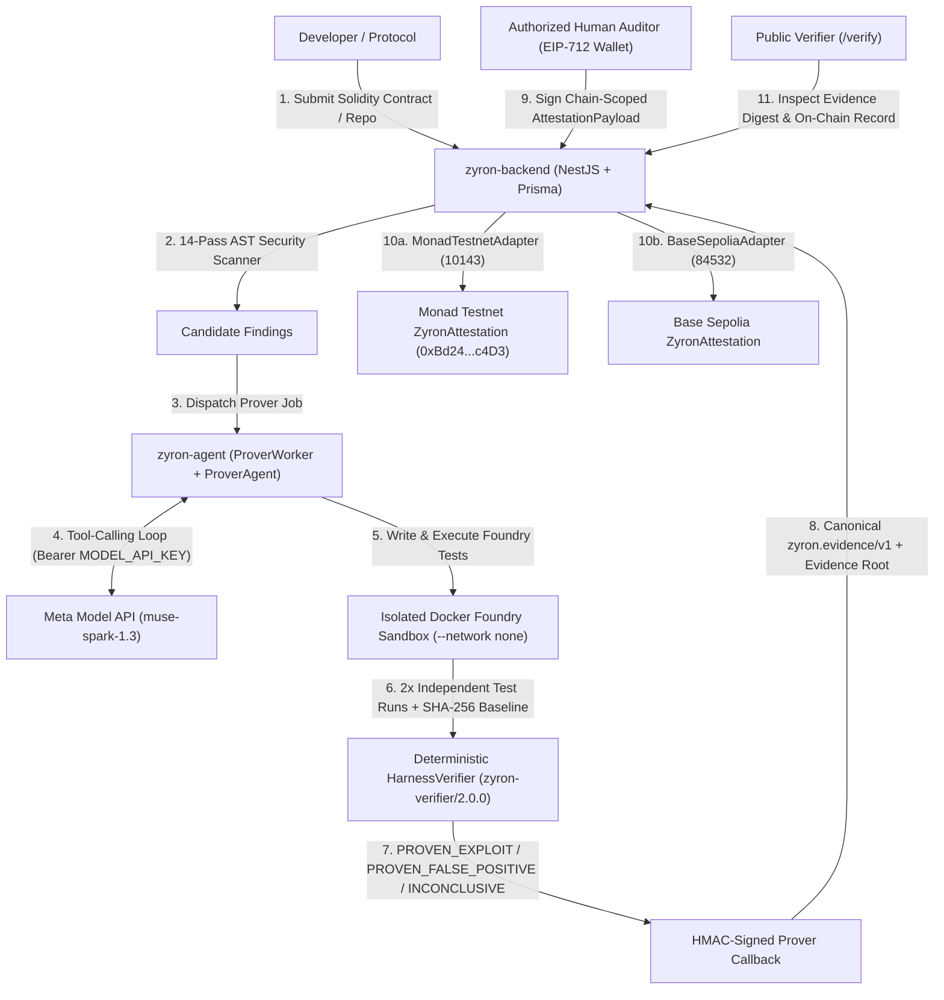

# Zyron Architecture — Meta-Powered AI Security Agents with Multichain Attestations

## Core Architectural Invariant

> **AI investigates, the isolated sandbox produces execution evidence, deterministic verification rules evaluate the evidence, and the blockchain records an authorized claim.**

The model (`muse-spark-1.3`) is never allowed to declare a vulnerability proven merely by generating a convincing explanation, nor can it authorize or sign an on-chain attestation.

---

## System Overview

---

## Monorepo Components

| Directory | Stack | Responsibilities |
|---|---|---|
| `zyron-agent/` | TypeScript, Express, Vitest, Docker + Foundry | Autonomous prover loop (`ProverAgent`), `MetaProvider` (`muse-spark-1.3`), strict tool policy (`tool-policy.ts`), deterministic `HarnessVerifier` (`zyron-verifier/2.0.0`), isolated `DockerExecutor`. |
| `backend/` | NestJS, TypeScript, Prisma, ethers v6 | 14-pass AST scanner, `MetaProviderService` + multi-provider factory, canonical `EvidenceHasherService` (`zyron.evidence/v1`), `ChainAdapterRegistry` (`MonadTestnetAdapter` + `BaseSepoliaAdapter`), EIP-712 signature verification, REST & WebSocket APIs. |
| `contracts/` | Solidity `^0.8.24`, Foundry, OpenZeppelin v5 | `ZyronAttestation.sol` (EIP-712 attestation registry + ERC-5192 soulbound security certificates), `GuardedByZyron.sol`, deployment manifests (`deployments/10143.json`, `deployments/84532.json`). |
| `frontend/` | Next.js 14, Tailwind CSS, Privy, ethers v6 | Client portal (`/portal/track/[id]`), Auditor code review & EIP-712 multichain signing (`/auditor/review/[id]`), and Public Attestation & Evidence Verifier (`/verify`). |
| `zyron-test-protocol/` | Solidity `^0.8.20` | Deliberately vulnerable `VaultCore.sol` fixture demonstrating `PROVEN_EXPLOIT`, `PROVEN_FALSE_POSITIVE`, and `INCONCLUSIVE` classifications. |

---

## Deterministic Verification Rules (`zyron-verifier/2.0.0`)

1. **Source Integrity**: Every original workspace contract file is hashed with SHA-256 at bootstrap. Before accepting any verdict, `HarnessVerifier` re-computes SHA-256 hashes of all target files and rejects any modification.
2. **Test Hygiene**: Generated Foundry tests must reside under `test/zyron/*.t.sol`, import the target contract, contain real assertions (`assert*` / `vm.expectRevert`), and must not use state-faking cheatcodes (`vm.etch`, `vm.store`, `vm.mockCall`, `vm.ffi`, `vm.coinbase`, `selfdestruct`).
3. **Classification Rules**:
   - `PROVEN_EXPLOIT`: Requires 2 consecutive passing `FOUNDRY_OFFLINE=true forge test --match-path ... --match-test ...` runs against unmodified target sources.
   - `PROVEN_FALSE_POSITIVE`: Requires a verbatim `counterevidenceGuard` string confirmed to exist in the unmodified target contract plus 2 consecutive passing counter-test runs.
   - `INCONCLUSIVE`: Assigned automatically whenever any check fails, the sandbox errors/times out, or the agent turn/time budget expires.
